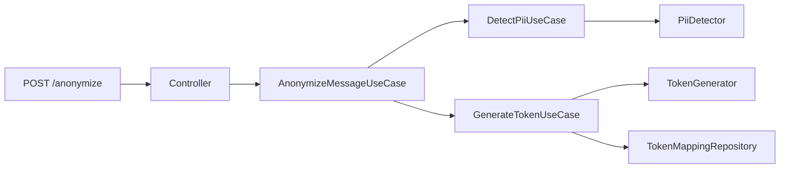

# Data Privacy Vault

Prueba de concepto para seudonimizar información personal identificable (PII) antes de que un mensaje llegue a otros sistemas.

`POST /anonymize` detecta nombres, correos y teléfonos, sustituye cada dato por un token hexadecimal y conserva el vínculo en un vault. La operación es **seudonimización**: el token no permite reconstruir el dato, pero el vault sí guarda la relación para una desanonimización controlada posterior. No es anonimización irreversible.

## Ejecutar

Requiere Node.js 20 o superior.

```bash
npm install
npm test
npm run dev
```

El servidor escucha en `http://localhost:3001`. El puerto se puede cambiar con la variable `PORT`.

```bash
curl -X POST http://localhost:3001/anonymize \
  -H "Content-Type: application/json" \
  -d "{\"message\":\"Oferta de trabajo para Dago Borda con email dborda@gmail.com y teléfono 3152319157\"}"
```

Respuesta:

```json
{
  "anonymizedMessage": "Oferta de trabajo para <token> con email <token> y teléfono <token>"
}
```

Cada token son 32 caracteres hexadecimales generados con `crypto.randomBytes`. No se calcula a partir del dato original. El mismo valor, dentro de la misma solicitud y mientras viva el proceso, recibe siempre el mismo token. Correo, teléfono y nombre se resuelven por separado.

## Arquitectura

El dominio no depende de Express ni de la forma en que se detecta o persiste. Los casos de uso orquestan contratos. Las implementaciones concretas se conectan solo en `src/main/createApp.ts`.



| Capa | Responsabilidad |
| --- | --- |
| `src/domain` | Entidades, token, tipos de PII y contratos del detector, del generador y del vault |
| `src/application` | Detección, emisión de tokens y sustitución en el mensaje |
| `src/infrastructure` | Reglas por tipo de PII, CSPRNG y vault en memoria |
| `src/presentation` | HTTP, validación y errores |
| `src/main` | Composición e inicio del proceso |

Para incorporar otro tipo de PII hay que extender `PiiType`, crear una estrategia de detección y registrarla en `createApp`. Los casos de uso no cambian.

`TokenMappingRepository.findByToken` deja listo el camino para un futuro caso de uso de desanonimización. Esta iteración no expone ese endpoint.

## Límites de esta iteración

- El detector de nombres reconoce secuencias de 2 a 4 palabras en formato título, con partículas en minúscula (`María de los Ángeles`). También marca secuencias como `Banco Andino`. No cubre nombres en minúscula, iniciales ni mayúsculas sostenidas.
- El teléfono cubre 10 dígitos locales, formatos separados y números internacionales con `+` de 10 a 15 dígitos.
- El vault es en memoria y guarda el valor normalizado en claro, porque la seudonimización debe poder revertirse. Se pierde al reiniciar el proceso. Un adaptador persistente debe cifrar ese valor en reposo y controlar quién puede resolver un token.
