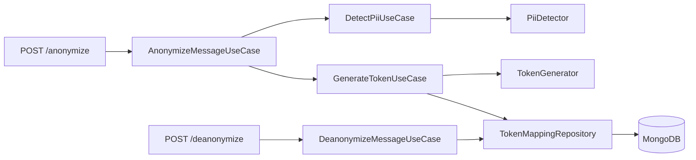

# Data Privacy Vault

Prueba de concepto para seudonimizar información personal identificable (PII) antes de que un mensaje llegue a otros sistemas.

`POST /anonymize` detecta nombres, correos y teléfonos, sustituye cada dato por un token y conserva el vínculo en un vault. `POST /deanonymize` restituye el texto original consultando solo ese vault. La operación es **seudonimización**: el token no permite reconstruir el dato, pero el vault sí guarda la relación. No es anonimización irreversible.

## Ejecutar

Requiere Node.js 20 o superior.

```bash
npm install
npm test
cp .env.example .env
```

La base es MongoDB Atlas. En `.env`, que no se commitea, van:

- `MONGODB_URI`: cadena `mongodb+srv://` del clúster. En Atlas, permite tu IP en Network Access y usa un usuario de base de datos.
- `MONGODB_DB_NAME`: base donde se crea `token_mappings`. Si se omite, el proceso usa `poc_anonymize`.

```bash
npm run dev
```

El servidor escucha en `http://localhost:3001`. El puerto se puede cambiar con la variable `PORT`.

```bash
curl -X POST http://localhost:3001/anonymize \
  -H "Content-Type: application/json" \
  -d "{\"message\":\"Oferta de trabajo para Dago Borda con email dborda@gmail.com y teléfono 3152319157\"}"
```

Respuesta:

```json
{
  "anonymizedMessage": "Oferta de trabajo para NAME_<secreto> con email EMAIL_<secreto> y teléfono PHONE_<secreto>"
}
```

El secreto son 32 caracteres hexadecimales generados con `crypto.randomBytes`. No se calcula a partir del dato original. El prefijo identifica el tipo y permite localizar el token sin modificar el caso de uso al agregar otro tipo de PII. El mismo valor normalizado recibe siempre el mismo token: la asociación queda en MongoDB y sobrevive al reinicio del proceso.

```bash
curl -X POST http://localhost:3001/deanonymize \
  -H "Content-Type: application/json" \
  -d "{\"anonymizedMessage\":\"Oferta de trabajo para NAME_<secreto> con email EMAIL_<secreto> y teléfono PHONE_<secreto>\"}"
```

```json
{
  "message": "Oferta de trabajo para Dago Borda con email dborda@gmail.com y teléfono 3152319157"
}
```

Cada asociación queda en `token_mappings` con `originalValue`, `normalizedValue`, `piiType` y `token`. Esa es la pareja dato–token del ejercicio; se consulta en Atlas. El token guardado es el secreto hexadecimal. En el mensaje aparece con el prefijo del tipo: `NAME_`, `EMAIL_` o `PHONE_`.

La desanonimización usa las asociaciones guardadas en MongoDB. Un mensaje sin tokens se devuelve igual. Un token con el prefijo correcto pero de longitud distinta se considera malformado. Si algún token bien formado no está en el vault, o el prefijo no corresponde al tipo guardado, la operación responde `422` y no devuelve una recuperación parcial. Si MongoDB no está disponible, la respuesta es `503`.

## Arquitectura

El dominio no depende de Express ni de la forma en que se detecta o persiste. Los casos de uso orquestan contratos. Las implementaciones concretas se conectan solo en `src/main/createApp.ts`.



| Capa | Responsabilidad |
| --- | --- |
| `src/domain` | Entidades, token, tipos de PII y contratos del detector, del generador y del vault |
| `src/application` | Detección, emisión de tokens, sustitución y restitución del mensaje |
| `src/infrastructure` | Reglas por tipo de PII, CSPRNG y vault en MongoDB |
| `src/presentation` | HTTP, validación y errores |
| `src/main` | Composición e inicio del proceso |

Para incorporar otro tipo de PII hay que extender `PiiType` y `PII_TOKEN_PREFIX`, crear una estrategia de detección y registrarla en `createApp`. Los casos de uso no cambian.

## Límites de esta iteración

- El detector de nombres reconoce secuencias de 2 a 4 palabras en formato título, con partículas en minúscula (`María de los Ángeles`). También marca secuencias como `Banco Andino`. No cubre nombres en minúscula, iniciales ni mayúsculas sostenidas.
- El teléfono cubre 10 dígitos locales, formatos separados y números internacionales con `+` de 10 a 15 dígitos.
- El proceso persiste el vínculo en MongoDB Atlas, en claro: `originalValue` junto al `token`. `normalizedValue` solo identifica el dato para reutilizar el mismo token. La arquitectura todavía no tiene tenant, así que el token y el dato son únicos en todo el vault. Las pruebas usan MongoDB en memoria y no se conectan a Atlas.
- Un mismo dato normalizado conserva el primer texto visto. `Ada@x.com` y `ADA@x.com` comparten token y la restitución devuelve la primera forma.
